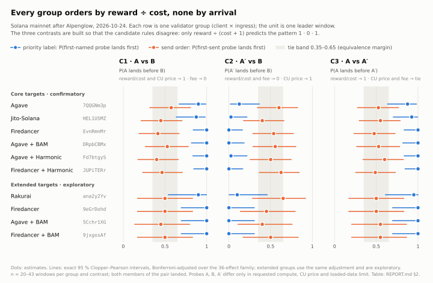
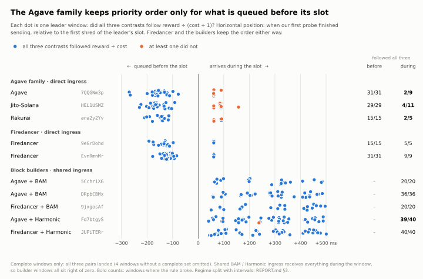
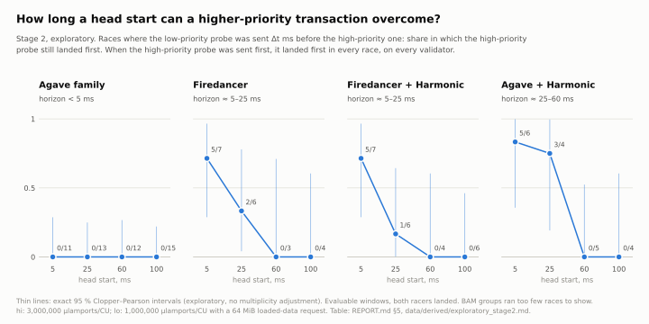
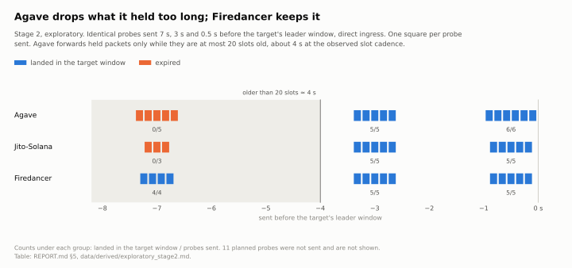
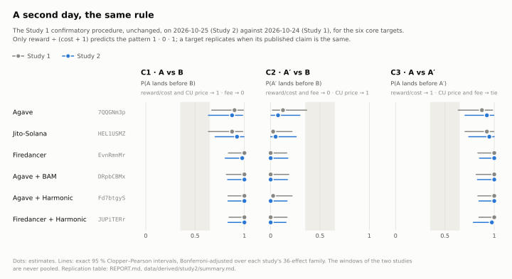
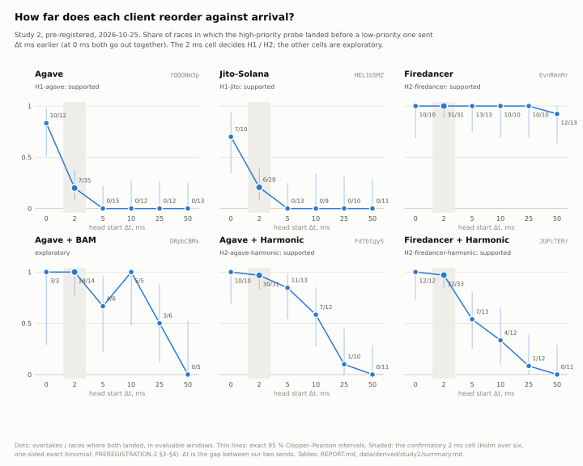
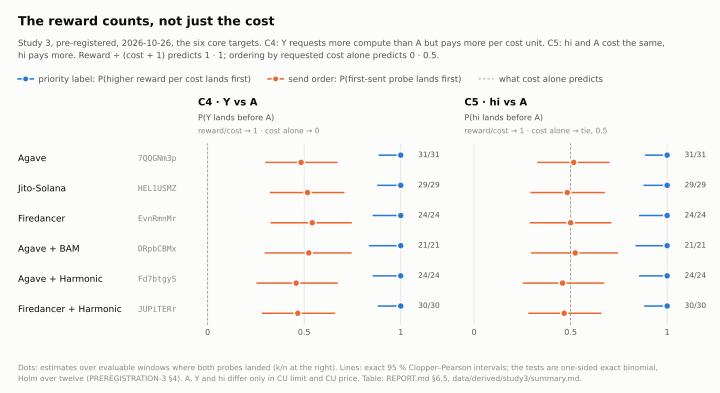

# Inside the Block — report

**Question.** By what rule does each validator order the transactions in its block, how strictly does the rule
hold, and is there a rule at all?

**Answer (post-Alpenglow mainnet, our own probe transactions; three pre-registered studies, 2026-10-24, 2026-10-25
and 2026-10-26).**

- **The rule.** All six core targets order our probes exactly as **Agave's priority, reward ÷ (cost + 1)**,
  predicts. This is the confirmatory result. A second pre-registered study replicated it the next day for all six.
  The four extended targets are exploratory and agree: two outright, one with "(assumes selection)" (`5Cchr1XG`) and
  one as `partial` (Rakurai). That makes 10 groups and 8 gossip client types, including BAM nodes and Harmonic block
  builders.
- **The reward counts, not just the cost.** Studies 1 and 2 could not tell reward ÷ cost from ordering by requested
  cost alone. A third pre-registered study added two contrasts where the two disagree:
  - a probe that costs more but pays more per cost unit;
  - two probes of equal cost with different rewards.

  In all 318 complete pairs, across the six core targets, the higher reward per cost unit landed first. Among the
  candidates registered across the three studies (CU price, lamport fee, cost alone, FIFO, random), each target's
  key is identified as reward ÷ (cost + 1), robust to selection (§6.5).
- **What it rules out, and what it does not.** CU price, lamport fee, cost alone, arrival order (FIFO) and "no rule"
  are all rejected. A key outside the registered set, such as reward − λ·cost, ranks every pair we ran the same way,
  so it is not excluded (§9).
- **Cost counts.** The *requested* compute and loaded-data limits enter the cost. A probe that pays the higher CU
  price but requests a 64 MiB data limit is placed after a cheaper one.
- **How strictly the rule holds depends on the client and on when the transactions arrive.**
  - Firedancer, BAM and Harmonic follow the rule in nearly every window, also for transactions arriving during the
    slot.
  - The Agave family (Agave, Jito-Solana, Rakurai) follows it perfectly for transactions already pending when the slot
    starts. For transactions arriving during its slot, it does not.
  - Study 2 measured how far each one reorders against arrival. In the Agave family, a higher-priority transaction
    overtakes a 2 ms head start in only 20 % of races, and a 5 ms one never.
  - Firedancer and the Harmonic builders overtake a 2 ms head start in 97–100 % of races (both pre-registered and
    supported). Their horizons run from 5–10 ms to beyond 50 ms (exploratory).
- **Ties.** Of two identical buffered probes, Firedancer lands the later-sent one first, in 50 of 54 pairs
  (pre-registered, supported).

`docker compose up` recomputes the three studies' results files and every figure from the raw data, and every
landing is checkable on chain (§10).
Each study was pre-registered before its first probe. The hashes are in mainnet Memos
[`5vRM47a8…QcyG`](https://explorer.solana.com/tx/5vRM47a8LfMLm1rQyQKdap292hmXk68kbad6Vf12nCxuzaZVGJSuL4g2DyLGNyZjsphPQLtVAqFkT3VxmRmLQcyg) (Study 1, slot 460,779,153),
[`2T6ha9FD…D5ww`](https://explorer.solana.com/tx/2T6ha9FDfjp524NLBXFB2WRHvEaYAoQLKFcd7Pmwqmf8FzqHi3Pxf8TcacHm7ixiN8UoyQizReCSSmh5LAR7D5ww) (Study 2, slot 461,151,605) and
[`2C57e22K…beUz5`](https://explorer.solana.com/tx/2C57e22K29Hj1v5z1J3Wrp3gXS717KQBrzVuMgPQKWhMX7Lv38VZmsWybxHK8A5JErxRW3JHq6dkXRtisRxbeUz5) (Study 3, slot 461,631,524).

## 1. When each measurement was taken (UTC, slots ≥ 460,725,000, post-Alpenglow)

| Date | Time (UTC) | What | Data | Role |
|---|---|---|---|---|
| 10-24 | 05:23 | Live smoke: reachability per ingress kind | `data/smoke/20261024T052311Z-smoke-live-f540` | engineering check |
| 10-24 | 07:18–07:48 | Pilot, stages 1 and 2 (70 windows) | `data/pilot/20261024T0718*`, `…0738*` | calibration, not confirmatory |
| 10-24 | 07:59–08:12 | Second pilot (30 windows), after execution fixes | `data/pilot/20261024T0759*`, `…0804*` | calibration, not confirmatory |
| 10-24 | 08:16:46 | **Pre-registration frozen**; Memo on mainnet | `docs/PREREGISTRATION.md`, `design/` | — |
| 10-24 | 10:31–12:58 | **Study 1, Stage 1** (413 windows) | `data/raw/20261024T103156Z-s1-live-916e` | **confirmatory** |
| 10-24 | 13:38–14:53 | Study 1, Stage 2 (T, H, S kits; 156 windows) | `data/raw/20261024T133825Z-s2-live-4ab3` | exploratory |
| 10-25 | 03:53–03:57 | Mainnet dry run of the Study 2 design (12 windows, nothing sent) | local only (`data/dryrun/`) | engineering check |
| 10-25 | 04:27 / 06:14 | **Pre-registration 2 frozen** / its Memo on mainnet | `docs/PREREGISTRATION-2.md`, `design/*study2*` | — |
| 10-25 | 06:15–09:04 | **Study 2, Stage 1**: replication (316 windows) | `data/raw/20261025T061534Z-s1-live-4e60` | **confirmatory** |
| 10-25 | 09:05–11:16 | **Study 2, Stage 2**: races and equal-key pairs (234 windows) | `data/raw/20261025T090530Z-s2-live-0b4f` | **confirmatory** (H1–H3) |
| 10-26 | 09:33–09:34 | Mainnet dry run of the final Study 3 design (8 windows, nothing sent) | local only (`data/dryrun/`) | engineering check |
| 10-26 | 10:32 / 10:33 | **Pre-registration 3 frozen** / its Memo on mainnet | `docs/PREREGISTRATION-3.md`, `design/*study3*` | — |
| 10-26 | 10:34–12:17 | **Study 3**: C4 and C5 (192 windows) | `data/raw/20261026T103425Z-s1-live-8da8` | **confirmatory** (H4, H5) |

Each step, its cost and its problems are in [docs/CAMPAIGN-LOG.md](docs/CAMPAIGN-LOG.md).

**Targets as identified at measurement time.** Client and version are what each validator advertised in gossip
(`target_states.jsonl` in every run), identical in every snapshot: 219 in Study 1, 301 in Study 2, 624 in Study 3.
The ingress kind is the endpoint we actually reached.

| Validator | Gossip client | Version | Ingress | Study 1 | Study 2 | Study 3 |
|---|---|---|---|---|---|---|
| `7QQGNm3p…` | Agave | 4.3.2 | direct | core | core (K, R) | core (N) |
| `HEL1USMZ…` | JitoLabs (Jito-Solana) | 4.3.2 | direct | core | core (K, R) | core (N) |
| `EvnRmnMr…` | Firedancer | 26.10.4 | direct | core | core (K, R) | core (N) |
| `DRpbCBMx…` | AgaveBam | 4.3.2 | BAM node | core | core (K, R) | core (N) |
| `Fd7btgyS…` | HarmonicAgave | 4.3.2 | Harmonic remote TPU | core | core (K, R) | core (N) |
| `JUPiTERr…` | HarmonicFiredancer | 26.10.4 | Harmonic remote TPU | core | core (K, R) | core (N) |
| `9eGrDohd…` | Firedancer | 26.10.4 | direct | extended | equal-key windows (E) | — |
| `9jxgosAf…` | FireBAM | 26.10.4 | BAM node | extended | — | — |
| `5Cchr1XG…` | AgaveBam | 4.3.2 | BAM node | extended | — | — |
| `ana2y2Yv…` | Rakurai | 4.3.2 | direct | extended | — | — |

Full identities: [`design/targets.json`](design/targets.json), [`design/targets-study2.json`](design/targets-study2.json),
[`design/targets-study3.json`](design/targets-study3.json).

## 2. Confirmatory result (PREREGISTRATION §1–§5)

L_C = P(x lands before y), with exact Clopper–Pearson intervals, Bonferroni-adjusted over the 36-effect family.
Windows are the unit, so n is the number of evaluable windows where both members of the pair landed.

<picture>
  <source media="(prefers-color-scheme: dark)" srcset="figures/identification-dark.svg">
  
</picture>


| Validator | Client | Ingress | L_C1 (A before B) | L_C2 (A′ before B) | L_C3 (A before A′) | Published claim | Strictness ≥ | Selection-robust |
|---|---|---|---|---|---|---|---|---|
| `7QQGNm3p` | Agave | direct | 0.90 [0.67, 0.99] n=40 | 0.12 [0.02, 0.36] n=40 | 0.88 [0.64, 0.98] n=40 | **reward_cost** | 0.70 | yes |
| `EvnRmnMr` | Firedancer | direct | 1.00 [0.84, 1.00] n=41 | 0.00 [0.00, 0.16] n=41 | 1.00 [0.83, 1.00] n=40 | **reward_cost** | 0.93 | yes |
| `HEL1USMZ` | Jito-Solana | direct | 0.88 [0.64, 0.98] n=40 | 0.03 [0.00, 0.22] n=40 | 0.93 [0.70, 1.00] n=40 | **reward_cost** | 0.70 | yes |
| `DRpbCBMx` | Agave + BAM | BAM node | 1.00 [0.82, 1.00] n=36 | 0.00 [0.00, 0.18] n=36 | 1.00 [0.82, 1.00] n=36 | **reward_cost** | 0.92 | yes |
| `Fd7btgyS` | Agave + Harmonic | Harmonic remote TPU | 1.00 [0.83, 1.00] n=40 | 0.03 [0.00, 0.22] n=40 | 1.00 [0.83, 1.00] n=40 | **reward_cost** | 0.89 | yes |
| `JUPiTERr` | Firedancer + Harmonic | Harmonic remote TPU | 1.00 [0.84, 1.00] n=43 | 0.00 [0.00, 0.17] n=40 | 1.00 [0.84, 1.00] n=43 | **reward_cost** | 0.93 | yes |
| `9eGrDohd` | Firedancer | direct | 1.00 [0.70, 1.00] n=20 | 0.00 [0.00, 0.30] n=20 | 1.00 [0.70, 1.00] n=20 | exploratory: reward_cost | 0.86 | yes |
| `9jxgosAf` | Firedancer + BAM | BAM node | 1.00 [0.70, 1.00] n=20 | 0.00 [0.00, 0.30] n=20 | 1.00 [0.70, 1.00] n=20 | exploratory: reward_cost | 0.86 | yes |
| `5Cchr1XG` | Agave + BAM | BAM node | 1.00 [0.70, 1.00] n=20 | 0.00 [0.00, 0.30] n=20 | 1.00 [0.70, 1.00] n=20 | exploratory: reward_cost (assumes selection) | 0.86 | no |
| `ana2y2Yv` | Rakurai | direct | 0.90 [0.54, 1.00] n=20 | 0.10 [0.00, 0.46] n=20 | 0.95 [0.61, 1.00] n=20 | exploratory: partial:reward_cost | 0.66 | yes |

- **Prediction pattern.** Among the pre-registered keys, only reward/cost predicts the pattern (x, y, x) on C1–C3.
  CU price predicts (x, x, tie) and lamport fee (y, y, tie), and both are rejected for every group. So are FIFO and
  "no rule", because the label effects are far from 0.5. Ordering by requested cost alone, which Study 1 did not
  register, predicts the same pattern. Study 3 rejects it (§6.5).
- **Send order.** P(first-sent member lands first) lies between 0.40 and 0.63 for every core contrast, and every
  interval contains 0.5. This rejects arrival order as an explanation of the label effects. It does not prove arrival
  plays no part: the intervals are too wide for the pre-registered equivalence test, so every send-order prediction
  of reward/cost is "undetermined", not confirmed. Randomisation p-values over the fixed family of 36 effects,
  Holm-adjusted: every label effect
  p = 0.00036, which is the floor of 1/100,001 for 100,000 draws after Holm's factor of 36. Every send-order effect
  has p = 1.0.
- **Gates (§9).** Both positive controls, Agave `7QQGNm3p` and Firedancer `EvnRmnMr`, recovered their known rule. No
  buffer or streaming gate fired, and the selection-balance check passed for every contrast (all p ≥ 0.15).
- **Inclusion (co-primary, PREREGISTRATION §1.3).** No group showed a label asymmetry in landing.
  - Per-label landing rates are 0.80–1.00, and the exact McNemar test gives p = 1.0 in all 30 group × contrast cells
    (`inclusion` in `results.json`).
  - The largest differences are single probes: Firedancer `EvnRmnMr` C3 at 40/41 vs 41/41, and `JUPiTERr` C2 at
    42/43 vs 41/43.
  - This does not establish label-blind selection (PREREGISTRATION §1 gives a counterexample); the worst-case bounds
    address that. Those bounds cover incomplete pairs inside evaluable windows, not windows excluded for sending
    failures.
- **Mixture diagnostic.** In every group the key-dependent component is reward/cost's, and only reward/cost's
  (`mixture` in `results.json`).
- **Stopping (§5).** Five core targets reached ≥ 40 informative pairs per contrast. `DRpbCBMx` used all 80 of its
  plans and stopped at 36, the pre-registered stop on exhausted plans. Its intervals are correspondingly wider, and
  the claim stands.

## 3. How strictly the rule holds — and when it does not

Strictness is the share of complete windows where *all three* contrasts went reward/cost's way (one-sided 95 %
lower bound). The send regime explains the gap between the two groups (sensitivity §6.4, regime split):

<picture>
  <source media="(prefers-color-scheme: dark)" srcset="figures/arrival-dark.svg">
  
</picture>


| Group | Buffered windows: probes arrive ≈ 150 ms before the leader's slot | Streaming windows: probes arrive during the window |
|---|---|---|
| Agave `7QQGNm3p` | L = 1.00 / 0.00 / 1.00 (n=31) | L = 0.56 / 0.56 / 0.44 (n=9) |
| Jito-Solana `HEL1USMZ` | 1.00 / 0.00 / 1.00 (n=29) | 0.55 / 0.09 / 0.73 (n=11) |
| Rakurai `ana2y2Yv` | 1.00 / 0.00 / 1.00 (n=15) | 0.60 / 0.40 / 0.80 (n=5) |
| Firedancer `EvnRmnMr` | 1.00 / 0.00 / 1.00 (n = 32 / 32 / 31) | 1.00 / 0.00 / 1.00 (n=9) |
| Firedancer `9eGrDohd` | 1.00 / 0.00 / 1.00 (n=15) | 1.00 / 0.00 / 1.00 (n=5) |
| BAM and Harmonic builders (shared ingress: every window streaming) | — | 1.00 / 0.00–0.03 / 1.00 (n=20–43 per group) |

- **Agave family.** When both members of a pair are already pending as the slot starts, the scheduler picks by
  priority every time. When they are sent 0.05 ms apart during the slot, the order looks unrelated to the label. It is
  also unrelated to the send order: the first-sent member wins between 27 % and 100 % of the time per contrast, all with wide intervals. That is
  consistent with Agave's multi-threaded banking stage, where near-simultaneous arrivals are taken by whichever thread
  is free. We cannot see the internal queue, and the streaming samples are small (n = 5–11), so this part is
  descriptive.
- **Firedancer (pack).** It keeps priority order even for transactions arriving during the slot.
- **Builders.** BAM nodes and Harmonic remote TPUs order by the same reward/cost key, even though they receive
  everything during the window. That is consistent with a builder that collects and sorts before forwarding. We
  see the final order, not the builder's queue.

## 4. Sensitivity analyses (PREREGISTRATION §6)

1. **Censored coding.** Two estimates change, because a few evaluable pairs had exactly one member landed:
   - Firedancer `EvnRmnMr` C3 goes from 40/40 to 40/41;
   - `JUPiTERr` C2 goes from 0/40 to 2/43.

   Every other estimate is identical, and every conclusion stands.
2. **Worst-case selection bounds.** Every core claim survives them, so it is selection-robust. `5Cchr1XG` does not:
   4 evaluable windows lost both members, so its claim carries "(assumes selection)".
3. **Session bootstrap.** Not informative: Stage 1 was a single run (one session).
4. **Regime split.** See §3.
5. **Achieved offsets** (C1). In every group, each window whose first send finished before the leader's first slot
   (bins < −100 ms and −100..0 ms) put A before B. The Agave-family exceptions are sends during the slot: the
   0..+100 ms bin, plus one Jito-Solana window above +100 ms.
6. **Including transition-ambiguous windows.** No campaign window was transition-ambiguous, so the analysis is
   identical.

## 5. Exploratory (Study 1, Stage 2, PREREGISTRATION §7)

All of this section is **exploratory** (PREREGISTRATION §7), descriptive, with plain 95 % Clopper–Pearson
intervals and no multiplicity claims. Study 2 (§6) then tested its race and tie-break findings confirmatorily. Full tables: [`data/derived/exploratory_stage2.md`](data/derived/exploratory_stage2.md),
from `scripts/exploratory_stage2.py`. 156 windows, 118 of them evaluable.

**Races: how big a head start can a higher-priority transaction overcome?**

<picture>
  <source media="(prefers-color-scheme: dark)" srcset="figures/races-dark.svg">
  
</picture>

- Each race pairs `hi` (3,000,000 µlamports/CU) against `lo` (1,000,000 µlamports/CU with a 64 MiB data request),
  one sent Δt ms after the other, starting just after the target's first shred. `hi` has the higher priority under
  every candidate key.
- When `hi` is sent first, it lands first in every race, at every Δt and every validator.
- When `lo` gets the head start:

| Group (targets) | Δt = 5 ms | 25 ms | 60 ms | 100 ms | Effective reordering horizon |
|---|---|---|---|---|---|
| Agave (`7QQGNm3p`) | 0/7 | 0/4 | 0/6 | 0/7 | < 5 ms |
| Jito-Solana (`HEL1USMZ`) | 0/3 | 0/7 | 0/5 | 0/5 | < 5 ms |
| Rakurai (`ana2y2Yv`) | 0/1 | 0/2 | 0/1 | 0/3 | < 5 ms (few races) |
| Firedancer, direct (`EvnRmnMr`, `9eGrDohd`) | 5/7 | 2/6 | 0/3 | 0/4 | ≈ 5–25 ms |
| Firedancer + Harmonic (`JUPiTERr`) | 5/7 | 1/6 | 0/4 | 0/6 | ≈ 5–25 ms |
| Agave + Harmonic (`Fd7btgyS`) | 5/6 | 3/4 | 0/5 | 0/4 | ≈ 25–60 ms |
| Agave + BAM (`DRpbCBMx`, `5Cchr1XG`) | 0/1 | 1/4 | 0/1 | 0/5 | too few races |
| Firedancer + BAM (`9jxgosAf`) | 2/2 | – | 2/2 | 0/1 | too few races |

(Cells: races in which `hi` overtook `lo`'s head start.)

- **Agave family:** once a transaction has arrived during the slot, a later one does not overtake it, even 5 ms later.
  That is consistent with the streaming-window result of §3.
- **Firedancer and the Harmonic builders:** they reorder within a short horizon.
- **BAM:** our race samples are too small to say.

**Uncontended C2: the same A′ and B probes on separate locks.** These are independent transactions that a
scheduler may run in parallel, so the probes need not land in priority order.
- Firedancer, Firedancer + BAM and Agave + BAM put B (the reward/cost-preferred one) first in every pair: 0/40, 0/19,
  0/36, 0/20 and 0/20 with A′ first.
- The Agave family and the Harmonic builders do not: A′ first in 13/40 (Agave), 18/40 (Jito-Solana), 5/20 (Rakurai),
  22/40 (Agave + Harmonic) and 12/42 (Firedancer + Harmonic).
- Only conflicting transactions are ordered strictly by the key everywhere.

**Equal-key order: two identical probes Δt apart.**
- Agave and Rakurai: the first-sent probe landed first in all 20 pairs (FIFO).
- Firedancer direct (`EvnRmnMr`, `9eGrDohd`): the *later* probe tended to land first at Δt = 10 ms (first-sent first
  4/20, CI 0.06–0.44), and not at 40 ms (8/18). The 10 ms result is the later-arrival-first tie-break that Firedancer's code predicts. With 38
  pairs, below the pre-registered threshold of 40, it counts as not identified.
- Harmonic and BAM groups: mostly FIFO (first-sent first 0.50–1.00 per group and Δt, small samples).

**Hold cliff: identical probes sent 7 s, 3 s and 0.5 s before the window.**

<picture>
  <source media="(prefers-color-scheme: dark)" srcset="figures/hold-dark.svg">
  
</picture>

- Agave and Jito-Solana: every probe sent 7 s early expired (8/8). Those sent 3 s and 0.5 s early landed (21/21).
  Agave drops packets held longer than 20 slots (≈ 4 s at the observed cadence).
- Firedancer: the 7 s probes landed in the target window (4/4). It keeps pending transactions until their blockhash
  expires.
- Both match the predictions from the clients' code, and the pilot.

**Spill-over: pre-window sends to shared ingress.**
- Probes sent 1 s and 150 ms before the target's window to a BAM node (`DRpbCBMx`) or a Harmonic remote TPU
  (`Fd7btgyS`, `JUPiTERr`): 28 of the 29 sent landed in the target window and 1 expired. None landed with the
  previous leader.
- This is consistent with the builders holding a transaction for the leader it was addressed to, rather than passing
  it to whoever leads at the moment. We see where each probe landed, not where it waited. This contradicts the
  spill-over that motivated the streaming regime for shared ingress (README §2).

## 6. Studies 2 and 3: a second day, how far each client reorders, and whether the reward counts (pre-registered)

Study 2 is §6.1–§6.4; Study 3 is §6.5–§6.6.

Study 2 was planned after Study 1 to close what Study 1 left open ([plan](docs/STUDY2-PLAN.md)):
- one day only;
- streaming samples of 5–11 windows;
- race cells of 1–7 races;
- a tie-break result two pairs short of its threshold.

It has its own normative plan, [PREREGISTRATION-2.md](docs/PREREGISTRATION-2.md), frozen after two independent reviews
([dispositions](docs/review/STUDY2-prefreeze-dispositions.md)). The hashes of that plan, the design and the manifest
are in mainnet Memo [`2T6ha9FD…D5ww`](https://explorer.solana.com/tx/2T6ha9FDfjp524NLBXFB2WRHvEaYAoQLKFcd7Pmwqmf8FzqHi3Pxf8TcacHm7ixiN8UoyQizReCSSmh5LAR7D5ww), posted before the first probe. The manifest also pins the git tree of the
analysis code. Operating characteristics, simulated under known schedulers: [POWER-2.md](docs/POWER-2.md).

Study 2 ran with a new wallet and its own ledger. That ledger carries Study 1's cost, so the compiled 0.05 SOL cap
covers both studies. Full tables: [`data/derived/study2/summary.md`](data/derived/study2/summary.md).

### 6.1 Replication (hypothesis R)

The Study 1 confirmatory procedure (PREREGISTRATION §1–§9), unchanged:
- the same six core targets in the same frozen groups;
- the same 36-effect family;
- the same decision rules and gates.

A target replicates when its published claim is the same as in Study 1.

<picture>
  <source media="(prefers-color-scheme: dark)" srcset="figures/study2-replication-dark.svg">
  
</picture>

| Target | Client | Ingress | Study 2: L_C1 / L_C2 / L_C3 | Study 1 claim | Study 2 claim | Replicated |
|---|---|---|---|---|---|---|
| `7QQGNm3p` | Agave | direct | 0.88 / 0.07 / 0.93 (n=40) | reward_cost | **reward_cost** | yes |
| `HEL1USMZ` | Jito-Solana | direct | 0.93 / 0.05 / 0.95 (n=40) | reward_cost | **reward_cost** | yes |
| `EvnRmnMr` | Firedancer | direct | 0.98 / 0.00 / 1.00 (n=45 / 38 / 45) | reward_cost | **reward_cost** | yes |
| `DRpbCBMx` | Agave + BAM | BAM node | 1.00 / 0.00 / 1.00 (n=39) | reward_cost | **reward_cost** | yes |
| `Fd7btgyS` | Agave + Harmonic | Harmonic remote TPU | 1.00 / 0.00 / 1.00 (n=40 / 40 / 43) | reward_cost | **reward_cost** | yes |
| `JUPiTERr` | Firedancer + Harmonic | Harmonic remote TPU | 1.00 / 0.00 / 0.98 (n=40 / 43 / 41) | reward_cost | **reward_cost** | yes |

- **Everything replicated:** all six claims, both positive controls, and selection-robustness for every claim. Send
  order again sits near 0.5: 0.425–0.575 for every core contrast.
- **The regime split replicated too:**
  - Agave and Jito-Solana follow the rule in every buffered window, but not in streaming ones:
    - Agave: 1.00 / 0.00 / 1.00 with n = 30, against 0.50 / 0.30 / 0.70 with n = 10;
    - Jito-Solana: 1.00 / 0.00 / 1.00, against 0.70 / 0.20 / 0.80.
  - Firedancer stays at 1.00 / 0.00 / 1.00 in streaming windows (n = 14 / 10 / 12).
- **Censored coding** changes estimates for three groups. The largest change is Firedancer C2, from 0/38 to 7/51.
  Every estimate stays on the same side of one half.
- **Stopping:** `DRpbCBMx` (39) and Firedancer's C2 (38) used all 56 plans. That is the pre-registered stop on
  exhausted plans.

### 6.2 Hypotheses H1–H3 (confirmatory)

A race pairs `hi` against `lo`, which ranks below it under every key, with `lo` sent Δt ms earlier. The two start
5 ms after the target's first shred. O(Δt) is the share of races in which `hi` still landed first.

The confirmatory test is in the 2 ms cell:
- one-sided exact binomial test against one half;
- Holm over six hypotheses;
- a selection bound;
- two gates.

<picture>
  <source media="(prefers-color-scheme: dark)" srcset="figures/study2-races-dark.svg">
  
</picture>

| Hypothesis | k / n | Estimate [95 % CI] | Holm p | Published claim |
|---|---|---|---|---|
| `H1-agave`: Agave, `hi` overtakes a 2 ms head start in fewer than half of the races | 7 / 35 | 0.20 [0.08, 0.37] | 0.0005 | **supported** |
| `H1-jito`: Jito-Solana, the same | 6 / 29 | 0.21 [0.08, 0.40] | 0.0012 | **supported** |
| `H2-firedancer`: Firedancer `EvnRmnMr`, in more than half | 31 / 31 | 1.00 [0.89, 1.00] | < 10⁻⁷ | **supported** |
| `H2-firedancer-harmonic`: Firedancer + Harmonic, the same | 32 / 33 | 0.97 [0.84, 1.00] | < 10⁻⁷ | **supported** |
| `H2-agave-harmonic`: Agave + Harmonic, the same | 30 / 31 | 0.97 [0.83, 1.00] | < 10⁻⁷ | **supported** |
| `H3-firedancer-ties`: of two identical buffered probes 10 ms apart, the later-sent one lands first in more than half of the pairs (first-sent first: k / n) | 4 / 54 | 0.07 [0.02, 0.18] | < 10⁻⁷ | **supported** |

- **Every claim is selection-robust, and no gate fired.**
  - Every probe Stage 2 sent landed, so no pair was incomplete.
  - The hi-first controls lost 0 of their 5–6 races per group.
  - The achieved send gaps had medians of 2.20–2.23 ms in the 2 ms cells and 10.25 ms for the equal-key pairs.
- **H3 per target:** `EvnRmnMr` 1/31 and `9eGrDohd` 3/23, the same direction.
  - In every one of the 54 pairs, both probes were sent before the leader's first shred.
  - Reading the result as a tie-break by later *arrival* assumes the network kept our send order (PREREGISTRATION-2
    §2).
- **Sensitivity:** all five pre-specified analyses give the same six verdicts:
  - censored coding;
  - including transition-ambiguous windows;
  - achieved gap within 0.5 ms;
  - same-slot pairs;
  - buffering evidence ("equal key both sent before first shred" in the summary table).

### 6.3 How far each client reorders (exploratory)

Cells: races in which `hi` landed first / races, both landed, evaluable windows. At 0 ms both probes go out together,
counted in either stream order.
- Exact 95 % intervals per cell are drawn in the figure above and listed in
  [`summary.md`](data/derived/study2/summary.md).
- The horizon bracket is a descriptive grid crossing: the last Δt whose observed share is at least one half, and the
  next Δt with data. It is not an interval for a true horizon.

| Group | 0 ms | 2 ms | 5 ms | 10 ms | 25 ms | 50 ms | Horizon bracket | Equal key, first-sent first (10 ms) |
|---|---|---|---|---|---|---|---|---|
| Agave `7QQGNm3p` | 10/12 | 7/35 | 0/15 | 0/12 | 0/12 | 0/13 | 0–2 ms | 23/35 |
| Jito-Solana `HEL1USMZ` | 7/10 | 6/29 | 0/13 | 0/9 | 0/10 | 0/11 | 0–2 ms | 10/29 |
| Firedancer + Harmonic `JUPiTERr` | 12/12 | 32/33 | 7/13 | 4/12 | 1/12 | 0/11 | 5–10 ms | – |
| Agave + Harmonic `Fd7btgyS` | 10/10 | 30/31 | 11/13 | 7/12 | 1/10 | 0/11 | 10–25 ms | – |
| Agave + BAM `DRpbCBMx` | 3/3 | 14/14 | 4/6 | 5/5 | 3/6 | 0/5 | 25–50 ms (non-monotone, small cells) | – |
| Firedancer `EvnRmnMr` | 10/10 | 31/31 | 13/13 | 10/10 | 10/10 | 12/13 | > 50 ms | 1/31 |
| Firedancer `9eGrDohd` (equal-key windows only) | – | – | – | – | – | – | – | 3/23 |

- **Agave family: priority acts only over a couple of milliseconds.**
  - Sent together at the start of the slot, the higher-priority probe lands first in 17 of 22 races.
  - With a 2 ms head start for the other one, it lands first in 13 of 64. From 5 ms on, it never does (0 of 95).
  - Together with the regime split, this fits a scheduler that orders what is waiting at the same moment. A
    transaction arriving a few milliseconds later meets one that is already being processed.
- **Firedancer `EvnRmnMr` held priority order against every head start up to 50 ms** (12 of 13 at 50 ms). In Study 1
  the Firedancer direct group reordered within about 5–25 ms. That group was pooled with `9eGrDohd` and had 3–7 races
  per cell. `EvnRmnMr` advertised the same version, 26.10.4, on both days. So the horizon is a property of a
  validator's setup on a given day, not a constant of the client or its version. Pack's scheduling intervals are
  configurable; we cannot see which setting changed.
- **The builders** reorder over 5–10 ms (Firedancer + Harmonic), 10–25 ms (Agave + Harmonic) and 25–50 ms
  (Agave + BAM). Study 1 had too few races to measure BAM at all.
- **Equal keys in the Agave family are not plain FIFO.** Both studies sent these pairs buffered (−150 ms,
  direct ingress), 10 ms apart:
  - Study 1: first-sent first in 7/7 pairs for Agave, 5/7 for Jito-Solana.
  - Study 2: 23/35 for Agave, 10/29 for Jito-Solana.

  It is descriptive, and outside any hypothesis.

### 6.4 What Study 2 changes in the answer

- The rule is not an artefact of one day or one session: the confirmatory procedure, rerun unchanged, gives the same
  claim for every core target.
- "How strictly" now has a measured scale. The Agave family's priority ordering spans about 2 ms of arrival. Firedancer
  and the builders reorder over tens of milliseconds, and the span differs between validators and days.
- Firedancer's equal-priority tie-break, unidentified in Study 1, is now confirmed among buffered probes:
  later-sent first.

### 6.5 Study 3: does the reward count? (confirmatory H4, H5)

Studies 1 and 2 left one gap open. Every contrast they ran ranks our probes by requested cost the same way
reward ÷ (cost + 1) does, so ordering by requested cost alone, cheapest first, would have produced the same data.
Study 3 was built to separate the two ([plan](docs/STUDY3-PLAN.md)).

Its normative plan, [PREREGISTRATION-3.md](docs/PREREGISTRATION-3.md), was frozen after two independent reviews and
two re-checks of the fixes ([dispositions](docs/review/STUDY3-prefreeze-dispositions.md)). The hashes of that plan,
the design and the manifest are in Memo
[`2C57e22K…beUz5`](https://explorer.solana.com/tx/2C57e22K29Hj1v5z1J3Wrp3gXS717KQBrzVuMgPQKWhMX7Lv38VZmsWybxHK8A5JErxRW3JHq6dkXRtisRxbeUz5).
The manifest also pins the analysis code's git tree, and it freezes each target's Study 1 and Study 2 claims, which
the verdict combines with. Operating characteristics: [POWER-3.md](docs/POWER-3.md). Full tables:
[`data/derived/study3/summary.md`](data/derived/study3/summary.md).

| Probe | CU limit | CU price (µlamports) | Cost | Reward | Agave priority |
|---|---|---|---|---|---|
| A | 1,000 | 1,000,000 | 2,335 | 3,500 | 1,498,287 |
| Y | 1,500 | 4,000,000 | 2,835 | 8,500 | 2,997,179 |
| hi | 1,000 | 3,000,000 | 2,335 | 5,500 | 2,354,452 |

- **C4, Y vs A.** Y costs more but pays more per cost unit. Reward ÷ cost puts Y first; cost alone puts A first. This
  holds whatever share of the signature fee a client counts as reward, under any shared cost overhead
  (PREREGISTRATION-3 §2).
- **C5, hi vs A.** The two cost the same. Reward ÷ cost puts hi first; cost alone ties.

Each of the 32 windows per core target held one C4 and one C5 pair. Send order was balanced, and payers were drawn
at random per window. Direct ingress sent buffered; BAM and Harmonic sent inside the window.

<picture>
  <source media="(prefers-color-scheme: dark)" srcset="figures/study3-contrasts-dark.svg">
  
</picture>

| Target | Client | Ingress | C4: Y before A | C5: hi before A | First sent first (C4 · C5) | §5 verdict |
|---|---|---|---|---|---|---|
| `7QQGNm3p` | Agave | direct | 31/31, 1.00 [0.89, 1.00] | 31/31, 1.00 [0.89, 1.00] | 15/31 · 16/31 | **identified** |
| `HEL1USMZ` | Jito-Solana | direct | 29/29, 1.00 [0.88, 1.00] | 29/29, 1.00 [0.88, 1.00] | 15/29 · 14/29 | **identified** |
| `EvnRmnMr` | Firedancer | direct | 24/24, 1.00 [0.86, 1.00] | 24/24, 1.00 [0.86, 1.00] | 13/24 · 12/24 | **identified** |
| `DRpbCBMx` | Agave + BAM | BAM node | 21/21, 1.00 [0.84, 1.00] | 21/21, 1.00 [0.84, 1.00] | 11/21 · 11/21 | **identified** |
| `Fd7btgyS` | Agave + Harmonic | Harmonic remote TPU | 24/24, 1.00 [0.86, 1.00] | 24/24, 1.00 [0.86, 1.00] | 11/24 · 11/24 | **identified** |
| `JUPiTERr` | Firedancer + Harmonic | Harmonic remote TPU | 30/30, 1.00 [0.88, 1.00] | 30/30, 1.00 [0.88, 1.00] | 14/30 · 14/30 | **identified** |

Cells: k/n over evaluable windows where both probes landed, with exact 95 % intervals. "Identified" is short for
"reward ÷ (cost + 1) identified among the registered candidates"; the Study 1 and Study 2 claims are `reward_cost`
for all six.

- **All twelve hypotheses are supported, every one robust to selection.**
  - Holm-adjusted p is below 10⁻⁶ for ten of them and about 10⁻⁶ for the BAM node's two.
  - The BAM node's worst-case bound, with its three incomplete pairs counted against it, is p = 1.4 × 10⁻⁴, below
    0.05/12.
  - Both positive controls passed without the qualifier, so no verdict carries "(assumes selection)".
- **Not one pair went the other way:** 318 of 318. The three sensitivity analyses (censored coding,
  transition-ambiguous windows included, same slot) give the same counts.
- **Send order does not explain it.** Per target and contrast, the first-sent probe landed first in between 0.46
  (11 of 24) and 0.54 (13 of 24) of the pairs.
- **No selection by label.** Five targets landed both probes in every evaluable window. The BAM node lost three whole
  windows, both probes each time. No evaluable window lost exactly one probe.
- **Windows:** 162 of 192 were evaluable. Each of the other 30 had a probe that was never sent (`not_all_sent`, no
  fee): 8 each for Firedancer, Agave + BAM and Agave + Harmonic, 3 for Jito-Solana, 2 for Firedancer + Harmonic and 1
  for Agave.
- **Scope of the regimes.** The Agave-family targets on direct ingress were sent buffered, where Studies 1 and 2 saw
  them follow the rule in every window. Study 3 does not test their streaming arrivals.

### 6.6 What Study 3 changes in the answer

- **The reward numerator is established**, for all six core targets:
  - at equal cost, the higher reward goes first (C5);
  - a higher requested cost is outweighed by a higher reward per cost unit (C4).

  Ordering by requested cost alone is rejected.
- **The key is identified.** Combined with the Study 1 and Study 2 claims frozen in the manifest, every core target's
  key is reward ÷ (cost + 1) among the registered candidates: CU price, lamport fee, cost alone, FIFO, random.
- **What is still not separated** (§9):
  - keys outside the registered set that rank all our pairs the same way, such as reward − λ·cost;
  - variants of the reward: the priority fee alone, or with half or all of the signature fee.

## 7. What went wrong

- **Connection eviction.** Busy servers evict unstaked QUIC connections from full tables between our pre-connect and
  the send. We first saw this in the smoke test; the worst cases are BAM nodes. Mitigation, before the freeze: the
  connection is re-checked before and after each anchor and re-handshaken when needed. Residual effect: 616 of 3,280
  Stage-1 probes were never sent. They cost nothing and their windows are excluded as `not_all_sent`.
- **`DRpbCBMx` fell short.** About half of its streaming windows were "late". A likely cause is the frozen concurrency
  of 2, which makes a window wait for a slot held by a previous window's outcome collection. It used all 80 plans and
  stopped at 36 informative pairs instead of 40.
- **Spam deposits.** Two strangers sent "dust" (8,505 and 4,518 lamports) to our payers. Reconciliation stayed safe,
  because the balances fell less than the fees charged. Both are recorded as external deposits
  (`scripts/foreign_transfers.py`).
- **Pre-freeze simulation design.** The simulation in POWER.md was first run on a draft design from an older build of
  the generator. It was rerun on the frozen design: same picture within 3 points. The frozen pre-registration quotes
  the draft's illustrative censored-coding figures. Censored coding recovered reward/cost in 50 % of campaigns at
  90 % landing (complete case: 99 %) and in 0 % at 50 % landing (complete case: 51 %). On the frozen design the
  figures are 47 % vs 99 % and 0 % vs 48 %.
- **Slot cadence assumed in the design.** The design took ≈ 130 ms per in-window slot (≈ 560 ms at the hand-over)
  from an early dry run. Every campaign run then measured ≈ 198 ms per in-window slot and 266–272 ms at the hand-over
  (median `cadence_at_prep`). The consequences:
  - The planned offsets only become more conservative. A race ending at +55 ms is further inside a 198 ms slot.
  - The shared-ingress burst offsets avoided ±15 ms around multiples of 130 ms instead of the real slot boundaries.
  - The estimands are window-wide, so a pair that crosses a slot boundary is analysed as planned (Study 2 has a
    same-slot sensitivity). POWER.md simulated 130 ms slots.
  - Study 3 was designed with the measured value: its shared-ingress offsets avoid ±15 ms around multiples of
    198 ms, and POWER-3 simulates 198 ms slots.
- **Line endings.** `design/targets.json` had CRLF endings from a Python text-mode write. It was normalised to LF
  before freezing, with its content unchanged. `scripts/freeze.py` now writes LF and refuses CR bytes in hashed files.
- **Study 2: the same weak spots, smaller.**
  - The far BAM node `DRpbCBMx` again lost the most probes before sending: 39 pairs from all 56 plans.
  - 288 of 1,896 Stage-1 probes and 244 of 1,518 Stage-2 probes were never sent (no fee). Every probe that was sent
    in Stage 2 landed.
  - The concurrency fix (§8) made Study 2 about three times faster than Study 1.
- **Study 2: problems found before the freeze.**
  - The two independent reviews found five blocking problems in the draft pre-registration and analysis. One example:
    simultaneous races counted as controls, where noise could withdraw a valid result.
  - Each was fixed, with a test, before the Memo
    ([dispositions](docs/review/STUDY2-prefreeze-dispositions.md)).
- **Study 2 ran on a Sunday.** The plan scheduled it for Monday 2026-10-26, a weekday. It ran on Sunday 2026-10-25,
  as soon as it was frozen and funded. The replication covers a second day, not weekday load.
- **Study 2: a platform-dependent string.** The Study 2 results first recorded the manifest path with a Windows
  backslash, so the Linux reproduction differed in that one field. The calling code now passes the path in POSIX
  form; the frozen decision code was not touched.
- **Study 3: problems found before the freeze.**
  - The first draft of probe Y (L 3,000, 2,000,000 µlamports/CU) would have lost C4 under a total-fee key. One of
    its verdicts also read a non-significant result as a rejection. Both were fixed before the Memo, along with the
    other review findings.
  - GPT's re-check of the fixes then found one more blocker: a selected run whose windows were all skipped would have
    crashed the analysis. It was fixed and tested before the freeze; a second re-check gave "FREEZE OK"
    ([dispositions](docs/review/STUDY3-prefreeze-dispositions.md)).
  - The first Study 3 dry run tested the first draft. A second dry run tested the final design.
- **Study 3: probes never sent.** 120 of 768 probes, in 30 windows, were never sent (no fee), mostly to Firedancer,
  the BAM node and Agave + Harmonic (8 windows each).
- **Earlier problems** found by the code reviews, the pilots and the localnet tests are listed with their fixes in
  [docs/review/CODE-gate1b-dispositions.md](docs/review/CODE-gate1b-dispositions.md) and
  [docs/CAMPAIGN-LOG.md](docs/CAMPAIGN-LOG.md).

## 8. Deviations from the pre-registrations

- **Analysis plan:** none. Estimands, decision rules, family, gates and stopping were applied as frozen.
- **Execution:** none. The frozen design (hash checked at run time) and the frozen parameters were used.
- **Exploratory items not computed (reporting deviation).** PREREGISTRATION §7 listed three exploratory analyses
  that we did not run:
  - block-structure statistics: a Chorus-style footrule, descending-run counts, and each probe's block-index
    percentile against its priority percentile;
  - the formal horizon-model fits (step, pending queue, linear batch, constant);
  - stratification by block fullness.

  The race tables and horizon brackets (§5, §6.3) are reported instead. The archived block excerpts in `data/raw`
  hold everything these analyses need.
- **Reporting fix after the freeze, no effect on any estimate:** the funnel labels a window that was skipped before
  any send (3 in Stage 1) only by its skip reason. Before the fix it was also labelled `design_mismatch` and so on.
- **Study 1 results file after Studies 2 and 3:** `data/derived/results.json` now lists the two Study 2 runs and the
  Study 3 run under `rejected_runs` (other budget and design). Every number is unchanged.

**Study 2 (PREREGISTRATION-2):**
- **Analysis plan:** none. Hypotheses, tests, Holm, selection bound, gates and sensitivity analyses were applied as
  frozen.
- **Execution:** none. The frozen design (hash checked at run time) and the frozen parameters were used.
- **Send concurrency:** a window now holds its concurrency slot only while preparing and sending, not during outcome
  collection. This tool change was announced in the plan and the pre-registration before the freeze, so it is not a
  deviation.
- **Analysis code:** the decision code (`study2.py` and the modules it uses) is byte-identical to the tree pinned in
  the manifest (`cd83bbc9`). Reporting code (tables, figures, the reproduce hook) was added after the freeze.
  `scripts/verify_frozen_study2.py` re-decides Study 2 with the pinned tree and reproduces every number.
- **Results file after Study 3:** `rejected_runs` now also lists the Study 3 run. Every number is unchanged.

**Study 3 (PREREGISTRATION-3):**
- **Analysis plan:** none. Hypotheses, tests, Holm, the selection bound, the positive-control gate, the
  identification verdict and the sensitivity analyses were applied as frozen.
- **Execution:** none. The frozen design (hash checked at run time) and the frozen parameters were used. All 192
  plans ran, with no data-dependent stopping.
- **Analysis code:** the Study 3 results were computed with the analysis tree pinned in the manifest (`be2eaf04`).
  Reporting code (a figure, the explorer, the ledger export) was added afterwards. `scripts/verify_frozen_study3.py`
  re-decides Study 3 with the pinned tree and reproduces every number.
- **Prior-claim files:** the manifest records the hashes of the Study 1 and Study 2 results files at the freeze
  commit (`ba141b8`). Those files have since gained the Study 3 run in `rejected_runs`, so their current hashes
  differ. The claims the verdict uses are frozen in the manifest itself and did not change.

## 9. What this design does not separate

- **Reward ÷ cost vs cost alone: separated by Study 3.** In Studies 1 and 2, every contrast and race ranked our
  probes by requested cost the same way reward ÷ (cost + 1) does (A 2,335 < B 4,335 < A′ 18,711; hi 2,335 < lo
  18,711). C3 established the cost term there, where price and fee tie; the reward numerator stayed open. Study 3's C4
  and C5 closed it (§6.5).
- **Keys outside the registered candidates.** An additive key, reward − λ·cost, ranks every pair of the three studies
  as reward ÷ cost does. With λ = 1: A 1,165, Y 5,665, hi 3,165, B −335, A′ −15,211. "Identified" therefore means
  among the registered candidates (CU price, lamport fee, cost alone, FIFO, random). Separating such keys needs pairs
  where reward ÷ cost and reward − λ·cost disagree, for every plausible λ.
- **Change over time.** The identification combines three studies run on three days. It assumes each target's key did
  not change between them.
- **Priority fee vs total fee.** With one signature they rank our probes identically. Study 3's Y wins C4 under
  either, and under any share of the signature fee counted as reward (PREREGISTRATION-3 §2).
- **A builder's own sort vs the validator's scheduler behind it.** BAM and Harmonic groups are reported as the
  ingress path we measured.
- **The Agave mechanism for streaming arrivals.** We observe that the label stops mattering, not the internal queue.
- **External validity.** Our probes are tiny, untipped, legacy transactions with one signature, two writable accounts
  and 600 CU executed. Heavier transactions, Jito bundles and tips, v1 transactions and contended accounts were out of
  scope.
- **Staked or SWQoS senders.** We are an unstaked sender. Eviction, landing and timing may differ for staked
  connections.
- **Send-side gaps (Study 2).** Δt is the gap between our two sends, measured at the sender. The gap at the scheduler
  can be larger or smaller. Equal-key results read as an arrival tie-break only if the network kept the send order.
- **Why a horizon is what it is.** We measure how far a validator reorders, not its scheduler's settings. Firedancer
  `EvnRmnMr`'s horizon differed between the two days for reasons we cannot see.

## 10. Verify and reproduce

```bash
docker compose up --build                       # all three studies: recompute every results file, redraw every figure, diff all
docker compose --profile verify up              # re-check a sample of landings against mainnet blocks
sha256sum docs/PREREGISTRATION.md design/design.jsonl design/campaign.json   # = the hashes in the Study 1 Memo
sha256sum docs/PREREGISTRATION-2.md design/design-study2.jsonl design/campaign-study2.json   # = the Study 2 Memo
sha256sum docs/PREREGISTRATION-3.md design/design-study3.jsonl design/campaign-study3.json   # = the Study 3 Memo
python scripts/verify_frozen_study2.py          # re-decide Study 2 with the analysis tree pinned in its manifest
python scripts/verify_frozen_study3.py          # the same for Study 3
```

**What the reproduction covers.** `docker compose up` recomputes `data/derived/results.json`,
`data/derived/study2/results.json` and `data/derived/study3/results.json` from `data/raw` and redraws every figure.
It compares all of them with the committed files, so every table in this report that comes from them is checked too.
It does not rerun:
- the simulation studies (`itb-analysis oc`, `scripts/oc_study2.py`, `scripts/oc_study3.py`);
- the cost accounting.

The cost accounting comes from the three spend ledgers, exported with every transaction signature and fee to
[`data/derived/ledgers/`](data/derived/ledgers/). Each landed fee there can be checked on chain.

**Probe explorer:** [docs/explorer](docs/explorer/index.html). Every window and every probe of the three studies,
with eligibility, landing slot and index, each linked to Solana Explorer (`python scripts/build_explorer.py`).

- **Archive check:** all 2,553 Stage-1 landing claims verified, with 26 checks each (signed bytes, signature,
  probe atom, block index, on-chain message, fee, leader, window). The completeness check found no probe in any of the
  1,640 archived window blocks without a matching claim.
- **Chain check:** a random sample of 60 claims verified against mainnet blocks fetched again from the RPC.
  [`data/derived/verify-archive.json`](data/derived/verify-archive.json),
  [`data/derived/verify-chain-sample.json`](data/derived/verify-chain-sample.json).
- **Study 2:** all 2,795 landings verified against the archive. The completeness check covered 2,200 archived window
  blocks and found no unclaimed probe. A random sample of 60 was verified against public mainnet RPC:
  [`data/derived/study2/verify-archive.json`](data/derived/study2/verify-archive.json),
  [`verify-chain-sample.json`](data/derived/study2/verify-chain-sample.json).
- **Study 3:** all 636 landings verified against the archive. The completeness check covered 768 archived window
  blocks and found no unclaimed probe. A random sample of 60 was verified against public mainnet RPC:
  [`data/derived/study3/verify-archive.json`](data/derived/study3/verify-archive.json),
  [`verify-chain-sample.json`](data/derived/study3/verify-chain-sample.json).

## 11. Cost

**All three studies together: 47,995,000 lamports (0.0480 SOL) on chain**, everything included, under the 0.05 SOL
cap. Every transaction of the three ledgers, with its signature,
purpose, status and fee: [`data/derived/ledgers/`](data/derived/ledgers/) (`scripts/export_ledgers.py`). The cap is
compiled into the binary. Each later ledger carries the cost of the studies before it, so the cap holds over all
three.

**Study 1.** All amounts in lamports, from the spend ledger (`state/ledger.sqlite`). The owned accounts' on-chain balances agree
to the lamport, once the two recorded spam deposits are counted.

| Step | Landed fees | Charged for expired probes | Probes never sent (no fee) |
|---|---|---|---|
| Smoke | 162,000 | 0 | 9 |
| Setup: payer funding (2) and pre-registration Memo | 15,000 | 0 | — |
| Pilots (100 windows) | 3,256,500 | 98,000 | 97 |
| Campaign Stage 1 (413 windows) | 15,797,000 | 686,500 | 616 |
| Campaign Stage 2 (156 windows) | 5,362,000 | 102,000 | 219 |
| Closing: sweep of the 24 payers and return of the remainder to the funder | 125,000 | 0 | — |
| **Total** | **24,717,500 (0.0247 SOL)** | **886,500** | |

The cap was 0.05 SOL, compiled into the binary and enforced by the ledger. The highest charge it ever held, after closing, was
0.0256 SOL (24,712,500 landed in its ledger plus 886,500 for expired probes). The wallet received 0.1 SOL, plus 13,023 lamports of spam deposits, and returned 75,295,523 lamports to its funder
([`5j8PEKpj…LA3D`](https://explorer.solana.com/tx/5j8PEKpj5djzEbXGwcqxqdut6HTkMG9h71TV16EoRKfXVfKKq3L1iSGM7AVJv79BjDjvUp5pCVcPUp62d4mJLA3D)). The difference, 24,717,500 lamports, is the whole cost of the measurement.

**Study 2.** From its ledger (`state/ledger-study2.sqlite`), opened with the compiled cap and Study 1's 24,717,500
lamports as a carry-over. The owned accounts' on-chain balances agree to the lamport.

| Step | Landed fees | Charged for expired probes | Probes never sent (no fee) |
|---|---|---|---|
| Setup: Memo, payer funding (2), top-up (2), sweep (24) | 145,000 | 0 | — |
| Stage 1, replication (316 windows) | 9,376,500 | 539,500 | 288 |
| Stage 2, races and equal keys (234 windows) | 8,682,000 | 0 | 244 |
| Closing: return of the remainder to the funder | 5,000 | 0 | — |
| **Total** | **18,208,500 (0.0182 SOL)** | **539,500** | |

The wallet received 0.06 SOL and held 41,796,500 lamports after the sweep, exactly 60,000,000 − 18,203,500. It returned
41,791,500 to its funder ([`3eZAJYz5…SHjHK`](https://explorer.solana.com/tx/3eZAJYz5rNbucd1Yu246uENE2gpseEDzbteA4jVswvuWt7nxXrS7nCsgSHnvTMLb1EDKYNEQhXqHdxWdS2rSHjHK), fee 5,000). The difference,
18,208,500 lamports (0.0182 SOL), is the whole cost of Study 2.

**Study 3.** From its ledger (`state/ledger-study3.sqlite`), opened with the compiled cap and Studies 1 and 2's
42,926,000 lamports as a carry-over. The owned accounts' on-chain balances agree to the lamport.

| Step | Landed fees | Charged for expired probes | Probes never sent (no fee) |
|---|---|---|---|
| Setup: Memo, payer funding (2), sweep (24) | 135,000 | 0 | — |
| Study 3 (192 windows, 636 landed probes) | 4,929,000 | 93,000 | 120 |
| Closing: return of the remainder to the funder | 5,000 | 0 | — |
| **Total** | **5,069,000 (0.0051 SOL)** | **93,000** | |

The wallet received 0.04 SOL and held 34,936,000 lamports after the sweep, exactly 40,000,000 − 5,064,000. It returned
34,931,000 to its funder ([`5im6rj2m…3BK8M`](https://explorer.solana.com/tx/5im6rj2mwHhmHUh8QWVLUuBUDw9eWTTGNzk9reEdmyWNWySQTCyTLQDt7brUBVrRHqTTjW7N6Ao63Tj58bn3BK8M), fee 5,000). The difference,
5,069,000 lamports (0.0051 SOL), is the whole cost of Study 3.
